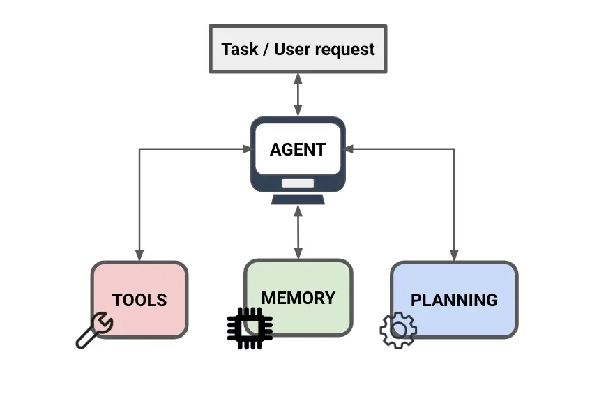

# tinyagent

*A tiny, dependency-free Python framework for learning how LLM agents work.*

tinyagent implements one agent loop in a few small, replaceable components. It is
for learning and experimentation, not a production agent platform.



The loop is:

```text
task → memory → LLM → planner.parse → tools.parse
         ↑                                  │
         └──── observation ←── tool ←───────┤ (tool call)
                                            └→ final answer
```

## Quick start

Install [uv](https://docs.astral.sh/uv/), then run from the repository:

```bash
uv sync
ollama pull gemma4:e4b
uv run python examples/minimal.py
```

The minimal example in [examples/minimal.py](examples/minimal.py):

```python
from tinyagent import LLM, TinyAgent

agent = TinyAgent.native(LLM(model="gemma4:e4b"))
print(agent.run("Explain in one sentence what memory does in an AI agent."))
```

The printed answer depends on the model. Ollama must be running with an
OpenAI-compatible API at `http://localhost:11434/v1`.

## Components

| Component | Classes | Description |
|-----------|---------|-------------|
| LLM | `LLM` | OpenAI-compatible chat client using the standard library |
| Planning | `NativeReAct`, `ReAct` | Native function calling or text-based ReAct |
| Tools | `NativeTools`, `Tools` | Python function registry with optional approval |
| Memory | `Memory`, `TrimmingMemory`, `SummarizationMemory`, `RAGMemory` | Four conversation-context strategies |
| Trajectory | `Trajectory` | Step-by-step run record, exportable as JSON |
| Evaluation | `Evaluator`, `Benchmark` | Run and score a collection of tasks |

## Guides

### Add a tool

Register the function directly. Its name, signature, type hints, and first
docstring line are used to describe it to the model:

```python
def lookup_topic(topic: str) -> str:
    """Look up a topic in the reference."""
    return f"Reference entry for {topic}"


tools.add_tool(lookup_topic)
```

`list[T]`, `T | None`, and `Literal[...]` annotations are represented in native
tool schemas. Parameter-level docstrings are not currently translated into
schema descriptions.

### Require approval

```python
from tinyagent import NativeTools

tools = NativeTools(requires_approval=["delete_record"])
```

The registered tool name must match the name in the approval list.

### Switch protocol

Use `TinyAgent.native(...)` with `NativeTools`, or `TinyAgent.text(...)` with
`Tools`. These constructors ensure the planner and tool parser match:

```python
agent = TinyAgent.native(LLM(model="gemma4:e4b"))
# Or for a model without native function calling:
agent = TinyAgent.text(LLM(model="gemma4:e4b"))
```

Pass tools and memory to either constructor when needed. `TinyAgent(...)` is
also available when you need to supply a custom planner and registry directly.

### Choose memory

- `Memory`: retain the entire conversation.
- `TrimmingMemory(max_turns=2)`: keep complete, recent task turns.
- `SummarizationMemory(llm)`: summarize completed runs, with additional LLM calls.
- `RAGMemory(embedding_model, documents, top_k=3)`: retrieve context for the
  latest task, with additional embedding calls.

See [examples/memory_demo.py](examples/memory_demo.py) for a compact comparison
and [examples/rag_demo.py](examples/rag_demo.py) for a complete RAG example.
The RAG demo uses `embeddinggemma`; install it with `ollama pull embeddinggemma`.

### Inspect a run

Set `verbose=True` to print thoughts, actions, observations, and answers as
they occur. The `agent.trajectory` object exposes structured steps and can be
saved with `agent.trajectory.save("trajectory.json")`.

### Use another provider

Configure an OpenAI-compatible endpoint and API key:

```python
llm = LLM(
    model="your-model",
    base_url="https://your-provider.example/v1",
    api_key="your-api-key",
)
```

Native tool calling and fields such as `reasoning_effort` vary between
providers; check the target endpoint's compatibility.

## Evaluation

The bundled IFEval-like and MMLU-Pro-like datasets contain **three examples
each** and are smoke tests of the evaluation harness, not full benchmark
results:

```bash
uv run python -m benchmarks.ifeval --mode text
uv run python -m benchmarks.mmlupro --model gemma4:e4b
```

Each run prints a report and saves JSON under `results/` by default. Override
the output path with `--output`. MMLU-Pro-style examples can also be loaded
from JSONL, one object containing `task` and `expected` per line:

```bash
uv run python -m benchmarks.mmlupro --data ./questions.jsonl --limit 20
```

IFEval smoke checks are intentionally simple approximations; for example, its
sentence limit check counts `.`, `!`, and `?` characters.

## Project layout

```text
src/tinyagent/       Framework source
benchmarks/          Runnable three-example smoke benchmarks
examples/            Minimal agent, study buddy, and memory demonstrations
tests/               Offline unit tests and opt-in integration test
image.png             Architecture overview
PLAN.md               Project roadmap
```

## Design and limitations

- One synchronous agent by design; no async, streaming, or multi-agent
  orchestration.
- Text-mode tool parsing relies on the model following the prompted JSON
  format. Invalid actions are returned to the model as observations.
- Small local models can loop; set `max_steps` to bound a run.
- The client is tested primarily against Ollama. Other compatible providers
  can differ in tool-call and reasoning-field behavior.
- Summarization and retrieval add LLM or embedding requests.
- The framework has no vector database or third-party runtime dependencies.

## Development

```bash
uv run pytest
uv run ruff check .
uv run ruff format --check .
```

The integration test requiring Ollama is skipped by default. The project
roadmap is in [PLAN.md](PLAN.md).

## License

tinyagent is distributed under the [MIT License](LICENSE).
