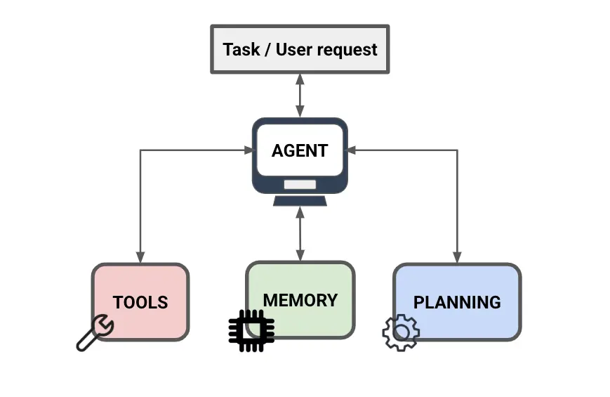

# tinyagent

**A small, modular Python framework for learning how LLM agents work.**

tinyagent connects a language model to a planning loop, conversation memory, and tools. Its components are deliberately simple and replaceable, making it useful for experimenting with agent designs without taking on a large framework.



## How it works

An agent receives a task and asks the configured language model what to do next. The planner shapes that decision, tools carry out actions, and memory provides conversation context. The agent repeats this cycle until the model returns a final response or the configured step limit is reached.

The main components are:

- **LLM**: Sends chat-completion requests to an OpenAI-compatible API. The included client uses Python's standard library.
- **Memory**: Stores conversation messages. Options include basic conversation memory, trimming, LLM-based summarization, and retrieval-augmented memory backed by embeddings.
- **Tools**: Registers Python functions for the agent to call. `NativeTools` builds function schemas for native tool calling; `Tools` uses a text-based JSON action format.
- **Planning**: `NativeReAct` uses the model's structured tool calls, while `ReAct` prompts the model to produce text in a ReAct-style format.

## Requirements

- Python 3.14 or newer
- [uv](https://docs.astral.sh/uv/) for the development workflow
- An OpenAI-compatible chat-completions endpoint for running an agent

There are no third-party runtime dependencies. The optional development dependency is Ruff.

## Getting started

From a checkout of this repository, sync the project environment:

```bash
uv sync
```

The repository includes a study companion example. With Ollama running and the `gemma4:e4b` model available, start it from the project root:

```bash
uv run python examples/study_buddy.py
```

The example defaults to native function calling and saves notes to `~/.tinyagent/study_buddy_notes.json`. To try the text-based ReAct implementation instead:

```bash
uv run python examples/study_buddy.py --mode text
```

You can change the model, API URL, notes file, or task:

```bash
uv run python examples/study_buddy.py \
  --model gemma4:e4b \
  --base-url http://localhost:11434/v1 \
  --notes-file ./study-notes.json \
  "Help me review Python functions"
```

## Build an agent

The following example registers a Python function as a tool and configures an agent for native function calling:

```python
from tinyagent.agent import TinyAgent
from tinyagent.llm import LLM
from tinyagent.memory import Memory
from tinyagent.planning import NativeReAct
from tinyagent.tools import NativeTools


def lookup_topic(topic: str) -> str:
	"""Look up a topic in the example's small reference."""
	reference = {
		"planning": "A planner selects the agent's next action.",
		"memory": "Memory keeps useful conversation context between steps.",
	}
	return reference.get(topic.lower(), f"No reference found for {topic}.")


tools = NativeTools()
tools.add_tool("lookup_topic", lookup_topic)

agent = TinyAgent(
	llm=LLM(
		model="gemma4:e4b",
		base_url="http://localhost:11434/v1",
	),
	memory=Memory(),
	tools=tools,
	planner=NativeReAct(max_steps=5),
)

print(agent.run("What does memory do in an agent?"))
```

For models that do not support native tool calling, use `Tools()` and `ReAct()` together. The example's `--mode text` option demonstrates this pairing.

## Project layout

```text
src/tinyagent/       Agent and composable framework components
examples/            Example agents
image.png             Architecture overview
```

## Current limitations

tinyagent is an educational, early-stage project. The text-based tool parser expects the model to follow the prompted JSON format. The LLM client currently keeps only the first tool call from a response, and native tool-result messages do not preserve the provider's tool-call ID; providers that require that ID may reject a follow-up request after a tool call. Provider compatibility can also vary, so verify native function calling with your chosen model and endpoint.
